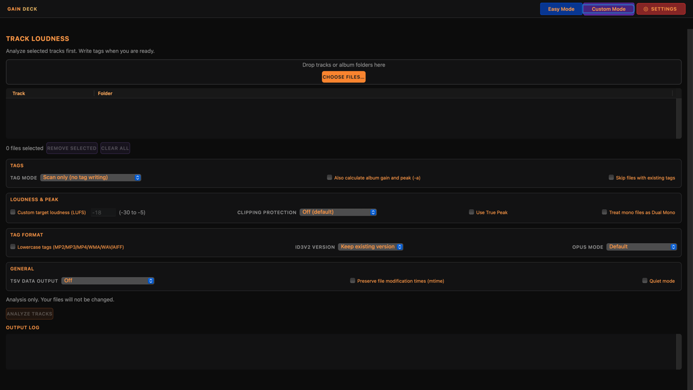
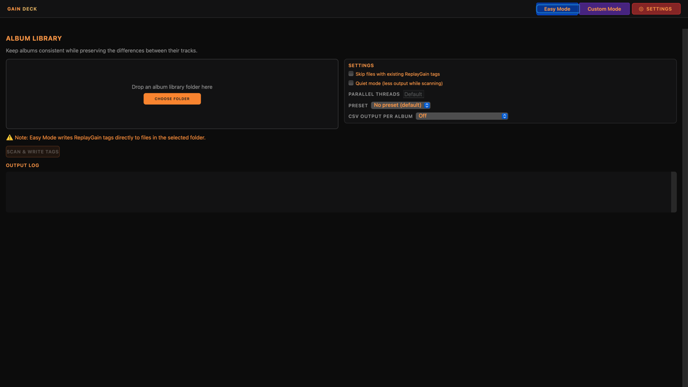
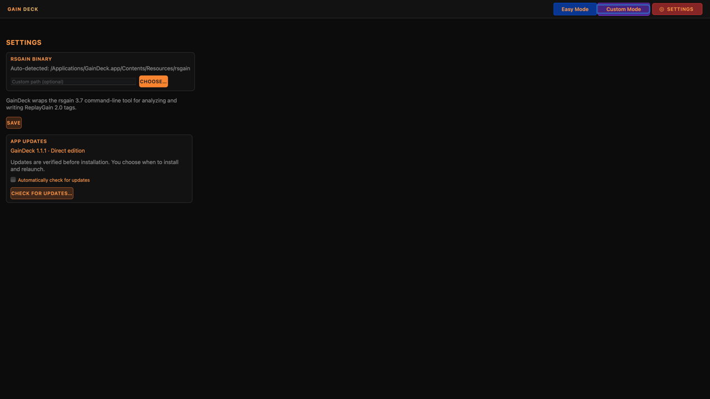

# GainDeck

Scan your music, review loudness and peaks, and write ReplayGain tags for more consistent playback in compatible players. A native Mac app powered by [rsgain](https://github.com/complexlogic/rsgain). A WEBServices product.

**GainDeck 1.1.1 RC 3 is available: Developer ID signed and notarized, build 5.**

App version: **1.1.1** (release candidate 3). **ReplayGain 2.0** is the loudness-tagging standard used by GainDeck; “2.0” is the standard’s version, not the app version.

[Download preview DMG](https://github.com/WEBServices-ORG/gaindeck-releases/releases/download/v1.1.1-rc.3/GainDeck-1.1.1-arm64.dmg) · [RC notes, checksums and engine sources](https://github.com/WEBServices-ORG/gaindeck-releases/releases/tag/v1.1.1-rc.3)

RC 3 adds vivid navigation buttons, larger orange/gray text, a wider folder chooser and an expanded About window. Four full-width groups remain. Existing RC users can use Check for Updates. Easy/Custom screenshots were verified; full keyboard and updater installation acceptance remain pending. This is a testing release; use copies of your audio.

[Website](https://webservices-org.github.io/gaindeck-releases/) · [Releases](https://github.com/WEBServices-ORG/gaindeck-releases/releases) · [Report an issue](https://github.com/WEBServices-ORG/gaindeck-releases/issues) · [Privacy](https://webservices-org.github.io/gaindeck-releases/privacy.html)

## Support

- [Support development](https://www.paypal.com/ncp/payment/VRVYW4BB3CH3L)
- [Email support](mailto:beacons_mobile_9k@icloud.com)
- [Report a bug or suggest an improvement](https://github.com/WEBServices-ORG/gaindeck-releases/issues)

## Scan first, tag when ready

1. **Choose your music.** Use Custom Mode to select individual tracks or folders.
2. **Check loudness first.** Set Tag mode to **Scan only (no tag writing)** to measure your music without changing tags. Enable tabular output to inspect loudness, gain, and peak values in the output log.
3. **Write tags when ready.** Select the tag-writing mode when you are ready to apply ReplayGain metadata. Audio is not re-encoded. Your player must support ReplayGain and have it enabled to use those tags.

Easy Mode handles album-library folders with presets and scan/tag options; check the selected options before running it. Try a copied album before processing your library.

[View the enlarged Tag mode control and workflow on the website](https://webservices-org.github.io/gaindeck-releases/).

## Screenshots

Custom Mode provides track analysis and tagging controls.

| Easy Mode | Settings |
| --- | --- |
|  |  |
| Choose an album folder, select a preset, and check scan/tag options. | Manage the audio engine and app updates. |

## Downloads and sources

This public repository hosts release information, downloads, the update feed, and issue reports. Application development remains in a separate private repository. Published binary releases will include their engine source archive and third-party notices.

ReplayGain needs a compatible player with the feature enabled. Test on a copied album before processing a library.

## More from WEBServices

[Update Shelf](https://webservices-org.github.io/update-shelf-releases/) · [YomVezman](https://webservices-org.github.io/yomvezman-releases/)
