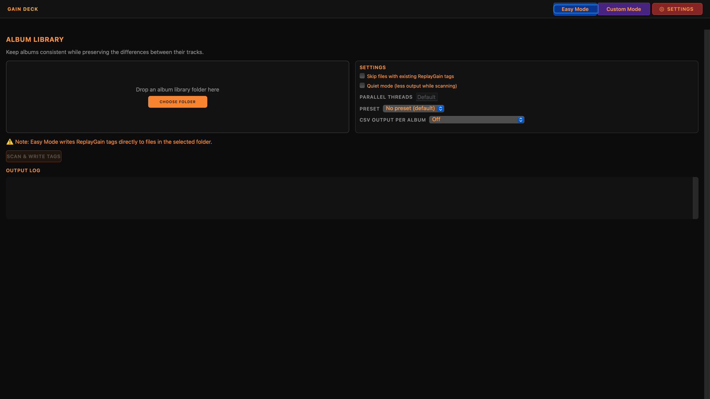

# GainDeck

A native Mac interface for ReplayGain loudness analysis and tagging, powered by [rsgain](https://github.com/complexlogic/rsgain). A WEBServices product.

**GainDeck 1.1.1 RC 3 is available: Developer ID signed and notarized, build 5.**

[Download preview DMG](https://github.com/WEBServices-ORG/gaindeck-releases/releases/download/v1.1.1-rc.3/GainDeck-1.1.1-arm64.dmg) · [RC notes, checksums and engine sources](https://github.com/WEBServices-ORG/gaindeck-releases/releases/tag/v1.1.1-rc.3)

RC 3 adds vivid navigation buttons, larger orange/gray text, a wider folder chooser and an expanded About window. Four full-width groups remain. Existing RC users can use Check for Updates. Easy/Custom screenshots were verified; full keyboard and updater installation acceptance remain pending. This is a testing release; use copies of your audio.

[Website](https://webservices-org.github.io/gaindeck-releases/) · [Releases](https://github.com/WEBServices-ORG/gaindeck-releases/releases) · [Report an issue](https://github.com/WEBServices-ORG/gaindeck-releases/issues) · [Privacy](https://webservices-org.github.io/gaindeck-releases/privacy.html)

## Support

- [Support development](https://www.paypal.com/ncp/payment/VRVYW4BB3CH3L)
- [Email support](mailto:beacons_mobile_9k@icloud.com)
- [Report a bug or suggest an improvement](https://github.com/WEBServices-ORG/gaindeck-releases/issues)

## Screenshots

Full HD screenshots: Easy Mode for album folders, Custom Mode for track analysis and tagging controls, and Settings for the audio engine and updates.

## Downloads and sources

This public repository hosts release information, downloads, the update feed, and issue reports. Application development remains in a separate private repository. Published binary releases will include their engine source archive and third-party notices.

ReplayGain needs a compatible player with the feature enabled. Test on a copied album before processing a library.

## More from WEBServices

[Update Shelf](https://webservices-org.github.io/update-shelf-releases/) · [YomVezman](https://webservices-org.github.io/yomvezman-releases/)
