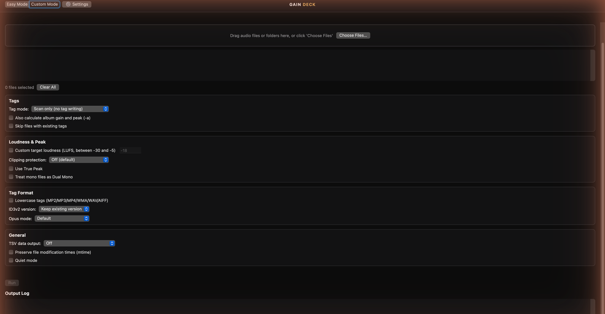

# GainDeck

A native Mac interface for ReplayGain loudness analysis and tagging, powered by [rsgain](https://github.com/complexlogic/rsgain). A WEBServices product.

**GainDeck 1.1.1 RC 2 is available: Developer ID signed and notarized, build 4.**

[Download preview DMG](https://github.com/WEBServices-ORG/gaindeck-releases/releases/download/v1.1.1-rc.2/GainDeck-1.1.1-arm64.dmg) · [RC notes, checksums and engine sources](https://github.com/WEBServices-ORG/gaindeck-releases/releases/tag/v1.1.1-rc.2)

RC 2 corrects Custom Mode to four full-width groups with left-to-right options inside each group. RC 1 users can use Check for Updates. Packaged GUI and updater installation checks remain pending. This is a testing release; use copies of your audio.

[Website](https://webservices-org.github.io/gaindeck-releases/) · [Releases](https://github.com/WEBServices-ORG/gaindeck-releases/releases) · [Report an issue](https://github.com/WEBServices-ORG/gaindeck-releases/issues) · [Privacy](https://webservices-org.github.io/gaindeck-releases/privacy.html)

## Support

- [Support development](https://www.paypal.com/ncp/payment/VRVYW4BB3CH3L)
- [Email support](mailto:beacons_mobile_9k@icloud.com)
- [Report a bug or suggest an improvement](https://github.com/WEBServices-ORG/gaindeck-releases/issues)

## Screenshots

This shows the historical 1.0.0 interface. New screenshots will follow verification of the refreshed RC.

## Downloads and sources

This public repository hosts release information, downloads, the update feed, and issue reports. Application development remains in a separate private repository. Published binary releases will include their engine source archive and third-party notices.

ReplayGain needs a compatible player with the feature enabled. Test on a copied album before processing a library.

## More from WEBServices

[Update Shelf](https://webservices-org.github.io/update-shelf-releases/) · [YomVezman](https://webservices-org.github.io/yomvezman-releases/)
